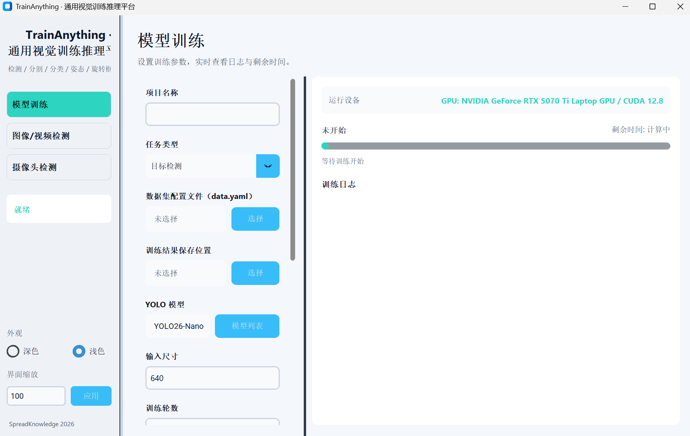

# TrainAnything · 通用视觉训练推理平台

一个基于 CustomTkinter 的桌面图形界面，把 YOLO 的**训练**与**推理**做成点击式操作：选数据集、选任务和模型、调参数、看实时日志，训练完直接在同一个界面里检测图片、视频或摄像头，视频还支持目标跟踪。面向不想记命令行参数的用户。

项目采用**插件化任务注册表**：任务与可选模型由 `src/plugins/` 声明，GUI 从注册表生成下拉列表，新增任务无需改动主界面。详见[扩展新任务](#扩展新任务)。

## 已内置任务（5 种 × 6 个 YOLO 家族）

| 任务 | 权重后缀 | 支持的家族 |
|---|---|---|
| 目标检测 detect | 无 | YOLO26 / 12 / 11 / v10 / v9 / v8 |
| 实例分割 segment | `-seg` | YOLO26 / 11 / v9 / v8 |
| 图像分类 classify | `-cls` | YOLO26 / 11 / v8 |
| 姿态估计 pose | `-pose` | YOLO26 / 11 / v8 |
| 旋转框检测 obb | `-obb` | YOLO26 / 11 / v8 |

> 家族可用性以 Ultralytics 官方发布的预训练权重为准。例如 YOLO12 官方只提供检测权重，因此其它任务的下拉列表里不会出现 YOLO12。

界面截图：



## 功能特性

- **多任务多模型**：一个界面覆盖检测、分割、分类、姿态、旋转框；切换任务时模型列表自动联动。
- **插件化架构**：任务/模型元数据集中在 `src/plugins/`，GUI 只读注册表；加任务不改主界面，且启动不加载 torch 等重型库，界面响应快。
- **目标跟踪**：视频与摄像头可用 ByteTrack / BoT-SORT，跨帧目标编号稳定，标签末尾追加 track_id。
- **训练进度可视化**：epoch 进度、剩余时间、实时 loss / mAP50 / mAP50-95 / Top1 指标。
- **灵活的数据集接入**：四类任务直接读 `data.yaml`，分类任务读数据集根目录。
- **推理方式多样**：单张图片、多张图片、整个文件夹、视频、摄像头。
- **标签按任务写出**：检测写框、分割追加多边形、姿态追加关键点、旋转框追加四角点、分类写类别与置信度。
- **结果自动归档**：训练权重、环境报告、检测图片与标签按时间戳分目录保存。
- **中文界面**：默认简体中文，深浅主题与界面缩放可调。

## 环境要求

- Python 3.9 – 3.12（推荐 3.10 或 3.11）
- Windows / Linux / macOS 均可
- NVIDIA GPU 可选：有则自动用 CUDA 训练，没有则用 CPU（速度会慢很多）

## 安装

建议使用 Python 自带的 `venv` 建虚拟环境，避免与其它项目依赖冲突。

### Windows（PowerShell）

```powershell
python -m venv venv
.\venv\Scripts\Activate.ps1
python -m pip install --upgrade pip
pip install -r requirements.txt
```

若激活脚本被策略拦截，先执行一次：

```powershell
Set-ExecutionPolicy -Scope Process -ExecutionPolicy Bypass
```

### Linux / macOS

```bash
python3 -m venv venv
source venv/bin/activate
python -m pip install --upgrade pip
pip install -r requirements.txt
```

### 关于 PyTorch 与 CUDA

`requirements.txt` 从 PyPI 安装 PyTorch，其默认 wheel 已包含 CUDA 12.x 运行时，NVIDIA 显卡可直接用。如需指定版本：

```bash
# CPU 版（无 NVIDIA 显卡，体积更小）
pip install torch torchvision --index-url https://download.pytorch.org/whl/cpu

# 指定 CUDA 12.4 版
pip install torch torchvision --index-url https://download.pytorch.org/whl/cu124
```

安装后用 `python -c "import torch; print(torch.cuda.is_available())"` 确认输出为 `True` 表示可用 GPU。

## 启动

在已激活的虚拟环境中运行：

```bash
python main.py
```

程序启动后默认最大化，左侧为导航栏：**模型训练**、**图像/视频检测**、**摄像头检测**。

## 数据集准备

这是最容易出错的一步。四类任务与分类任务的数据集格式**不通用**，按任务分别准备。

### 检测 / 分割 / 姿态 / 旋转框：用 `data.yaml`

这四类共用同一种 `data.yaml` 结构，区别只在标签内容：

```yaml
path: E:/你的数据集/数据集名
train: E:/你的数据集/数据集名/train/images
val:   E:/你的数据集/数据集名/valid/images
nc: 3
names: ['aircraft', 'bird', 'drone']
```

- `path`、`train`、`val` 建议写绝对路径，避免相对路径解析出问题。
- 验证集目录名以实际为准（`valid` 或 `val` 都可以，yaml 里写对即可）。
- `names` 的顺序决定类别 ID：第 0 个对应标签里的 `0`。
- 标签放在与 `images` 同级的 `labels` 目录，Ultralytics 会自动按文件名对应，无需手动指定。

各任务的标签格式（每行一个目标）：

| 任务 | 标签行格式 |
|---|---|
| 检测 | `cls xc yc w h` |
| 分割 | `cls xc yc w h px1 py1 px2 py2 ...`（归一化多边形） |
| 姿态 | `cls xc yc w h kx1 ky1 kv1 kx2 ky2 kv2 ...` |
| 旋转框 | `cls x1 y1 x2 y2 x3 y3 x4 y4`（四个角点） |

> 同一份 yaml 可以切到任意前四类任务，但**数据本身必须匹配**——拿检测框去训分割会报错。项目已在 `Dataset/` 目录内置 Ultralytics 官方迷你数据集（`coco8` / `coco8-seg` / `coco8-pose` / `dota8` / `imagenet10`，每套 8~24 张图）：clone 后把对应 `data.yaml` 里的 `path` 改成你本机的绝对路径（只改这一行），即可直接跑通全部任务；也可以从 [Ultralytics assets](https://github.com/ultralytics/assets/releases) 下载其它版本。

### 图像分类：用数据集根目录

分类任务**不用 `data.yaml`**，类别直接来自文件夹名：

```
imagenet10/
  train/
    n01440764/   ← 文件夹名就是类别名
    n01443537/
    ...
  val/
    n01440764/
    ...
```

- 界面选数据集时，分类任务选的是**根目录**（含 `train/`、`val/` 的那一层），不是 yaml 文件。
- 类别 ID 按文件夹名**字母序**分配。
- 无需任何标签文件，图片丢进对应类别文件夹即可。
- 官方迷你数据集：`imagenet10`（10 类、24 张图），下载后解压即可用。

## 功能说明

### 1. 模型训练

| 字段 | 说明 |
|---|---|
| 项目名称 | 实验名，只用字母、数字、连字符、下划线，如 `duck_detection_001`。也是结果文件夹名 |
| 数据集 | 四类任务选 `data.yaml`；分类任务选数据集根目录 |
| 训练结果保存位置 | 权重和日志写到 `保存位置/项目名称/` |
| 任务类型 | 检测 / 分割 / 分类 / 姿态 / 旋转框，切换后模型列表联动 |
| YOLO 模型 | 按任务筛选的预训练权重，如 `YOLO26-Nano`、`YOLO11-Nano-seg` |
| 输入尺寸 | 训练图片尺寸，常用 `640`；分类可用 `224` |
| 训练轮数 | epoch 数，如 `100`；小数据集测试用 `5`~`10` 即可 |
| 批量大小 | batch size，如 `16`；显存不足就调小（如 `4`） |
| 运行设备 | 自动 / GPU（CUDA）/ CPU。自动和 GPU 均为"有 GPU 就用，否则回退 CPU"；CPU 强制不用显卡 |
| 早停轮数 | 验证指标连续 N 轮无提升则自动停止，存的是最佳权重。`0` 表示不早停 |
| 初始学习率 | 默认 `0.01` |
| 从上次断点继续训练 | 训练中断后勾选，从 `weights/last.pt` 续训；无断点则自动从零开始 |
| 启用数据增强 | 训练时随机翻转、旋转、缩放、变色等，提升泛化、防止过拟合。默认开启 |

点击**开始训练**后，可实时看到进度条、剩余时间、loss / mAP / Top1 指标和日志；训练中相关控件锁定，按钮变为可点击停止。

训练权重保存在：

```
保存位置/项目名称/weights/best.pt     ← 最佳权重
保存位置/项目名称/weights/last.pt     ← 最后一轮权重（续训用）
```

同目录还会生成 `training_environment.txt`，记录 Python 库版本、CUDA/cuDNN、显卡型号与显存等环境信息，便于复现实验。

> 首次训练会自动从 GitHub 下载所选权重（约 5 MB 起）。国内网络可能失败，届时手动下载 `.pt` 放到项目根目录即可。

### 2. 图像 / 视频检测

- **图像/视频文件夹**：递归扫描文件夹内的图片和视频；也可用**选择图片文件（可多选）**只检测指定图片。
- **检测模型 (.pt)**：选训练好的权重，通常是 `weights/best.pt`。
- **置信度**：`0.01` ~ `1.0`，默认 `0.5`。调低检出更多但误报增多。
- **启用目标跟踪**：仅对视频有效。开启后选跟踪器：
  - `ByteTrack`：速度快，通用首选（默认）
  - `BoT-SORT`：精度略高，速度稍慢
  - 跟踪用 `persist=True` 保持跨帧目标 ID 稳定，图片仍走普通检测（勾了也无效）。分类模型无目标框，跟踪自动禁用。

结果保存在数据源目录下的 `results/时间戳/`：

```
results/时间戳/images/   ← 画好框/多边形/关键点的图片
results/时间戳/labels/   ← 按任务格式写的标签 txt
```

视频会额外输出带标注的 `xxx_detection.mp4` 和检出帧。开启跟踪时，视频标签行末尾追加目标编号：

```
cls conf x1 y1 x2 y2 track_id
```

检测完可用上一张/下一张按钮或 `←` / `→` 键浏览预览。

> 图片逐张推理，不会一次性把整个文件夹读进内存，大批量检测也不会爆内存。

### 3. 摄像头检测

- **检测模型 (.pt)**：同样选训练好的权重。
- **保存文件夹**：截图和标签的存放位置。
- **摄像头设备**：下拉选择，接了新设备点**刷新**。
- **置信度**：同上。
- **启用目标跟踪 / 跟踪器**：同检测页，实时画面在类别旁显示 `ID编号`，截图标签末尾追加编号。

点击**开始**后实时显示检测结果：

- `Enter`：保存当前帧
- `Esc` 或**停止**：结束检测

每次保存生成三个文件：

```
时间戳_场景号_origin.png       ← 原图
时间戳_场景号_detection.jpg    ← 标注图
时间戳_场景号_detection.txt    ← 检测标签
```

### 侧边栏设置

- **外观**：深色 / 浅色主题。
- **界面缩放**：百分比，范围 70–170，`100` 为原始大小。

训练或检测运行期间，侧边栏设置会被锁定，避免界面重建打断任务。

## 常见问题

**Q：提示 `FileNotFoundError: 'xxx.pt'`**
所选权重本地没有且自动下载失败。手动从 Ultralytics 官方 assets 下载对应 `.pt`，放到项目根目录后重试。注意 YOLO12 官方只有检测权重。

**Q：CUDA 不可用 / 训练走 CPU**
按上面"关于 PyTorch 与 CUDA"确认 `torch.cuda.is_available()`。常见原因：NVIDIA 驱动过旧、装了 CPU 版 torch、虚拟环境不对。

**Q：训练报显存不足（CUDA out of memory）**
把批量大小调小（如 `16` → `4`），或把输入尺寸调小（如 `640` → `320`）。关闭其它占显存的程序。

**Q：分类任务选 yaml 报错**
分类必须选**数据集根目录**，不是 yaml 文件。这是 Ultralytics 的限制，不是界面 bug。

**Q：检测结果里类别名是英文 / 和预期不符**
类别名来自训练时固化的权重。想显示中文，把训练集的类别文件夹或 yaml `names` 直接写成中文后重新训练。

## 项目结构

```
main.py                    程序入口
gui_image/                 界面截图（README 引用）
Dataset/                   内置迷你测试数据集（Ultralytics 官方），clone 后即可验证五种任务
  coco8/                   目标检测，8 图，含 data.yaml
  coco8-seg/               实例分割，8 图，含 data.yaml
  coco8-pose/              姿态估计，8 图，含 data.yaml
  dota8/                   旋转框检测，8 图，含 data.yaml
  imagenet10/              图像分类，train/val 按类别文件夹组织，无需 yaml
src/gui_app.py             CustomTkinter 界面，从插件注册表生成任务/模型下拉
src/gui_text.py            界面文案（中/日/英，默认中文）
src/plugins/               任务插件注册表（纯元数据，无重型依赖）
  base.py                  TaskPlugin 定义、register()、派生数据函数
  yolo.py                  YOLO 五任务插件声明
src/train.py               训练参数解析、训练执行、环境报告
src/detect.py              图片/视频推理，按任务写标签，视频跟踪
src/camera.py              摄像头实时检测、跟踪与截图
src/system_report.py       训练环境信息采集
src/calculate_metrics.py   指标计算辅助
src/xml_to_txt.py          XML 标注转 YOLO txt 辅助
requirements.txt           依赖清单
LICENSE                    AGPL-3.0 许可证
```

> 预训练权重（`*.pt`）与训练输出（`runs/`）体积大，不入仓库（见 `.gitignore`）；首次训练会自动下载所选权重，训练产物生成在你指定的保存位置。`Dataset/` 各数据集里的 `runs/` 属于本地调试产物，同样会被忽略上传。

## 扩展新任务

任务与模型列表不写死在界面里，全部来自 `src/plugins/`。加一个新任务只需两步：

**1. 新建插件模块**（如 `src/plugins/my_task.py`）：

```python
from .base import TaskPlugin, register

def register_my_task():
    register(TaskPlugin(
        key="my_task",                    # 对应 gui_text 的 task_my_task 文案键
        model_suffix="-xxx",              # 权重后缀，无则空字符串
        families=(("MyModel", "mymodel", (("Nano", "n"), ("Small", "s"))),),
        #          显示名   权重前缀        尺寸档位（显示名, 后缀）
        dataset_kind="file",              # file=选 data.yaml；folder=选数据集根目录
        supports_track=False,             # 视频/摄像头是否支持目标跟踪
    ))
```

**2. 在 `src/plugins/__init__.py` 导入并注册**：

```python
from .my_task import register_my_task
register_my_task()
```

重启程序，任务下拉里就出现新任务，模型列表、数据集选择方式、跟踪开关都按插件声明自动生效。界面代码 `gui_app.py` 不用改。

> 设计约束：`src/plugins/` 只放元数据，**不要**在此 import torch / ultralytics / cv2，否则 GUI 启动会变慢。实际训练/推理仍放在独立模块的子进程/子线程中执行。

## 许可证

本项目采用 [GNU Affero General Public License v3.0](LICENSE) 开源。基于 Ultralytics YOLO 构建，使用时请同时遵守其许可条款。
